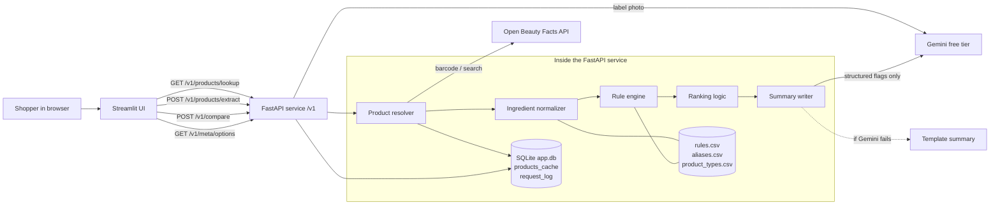

# ARCHITECTURE.md: Skincare and Haircare Product Comparison Tool

> Status: **Draft for review.** Nothing has been built yet. Please read, mark anything you disagree with, and approve before Phase 1 starts.
>
> How to read this doc: each section starts with a short plain-language summary in a quote box like this one. The details underneath are there for when we build. You don't need to understand every technical word on the first read.

---

## 0. Assumptions (things I had to decide because the brief left them open)

You can change any of these. Each one is numbered so you can say "change A4" when you review.

| # | Assumption | Why |
|---|---|---|
| A1 | **The AI model is Google Gemini on its free tier** (a "Flash" model, which can read photos and write text). | You want nothing paid except Claude Code. Gemini has a free tier with photo reading. Claude's own API is paid, so the app itself won't use it. Claude Code is only the helper that builds the app with you. |
| A2 | **"Suitable database" = one local SQLite file** (`data/app.db`). It holds only the product cache and a request log. | SQLite is free, built into Python, and is just a file on your computer. It is not a hosted database, so it fits the "no hosted database" rule. No user data or profile is ever stored in it. |
| A3 | **The app runs on your own computer first.** Putting it online for free is optional and comes at the end (see Phase 7 and the caveats in section 2). | Free hosting has limits (apps sleep, files get wiped). Running locally avoids all of that while you learn. |
| A4 | **The rule table also holds the concerns.** The `relevant_profiles` column uses tags such as `concern:acne-prone` or `profile:sensitive`. A concern appears in the dropdown only if at least one rule for that product type carries its `concern:` tag. | The brief says the rule table drives the dropdown but lists no "concern" column. This keeps the exact columns you asked for. |
| A5 | **One small extra file, `product_types.csv`**, lists each product type, whether it is skin or hair, and whether it is leave-on or rinse-off. | The ranking needs leave-on vs rinse-off, and this keeps it in a file you can edit instead of hidden in code. |
| A6 | **Face mask counts as rinse-off.** Lip balm, sunscreen, serum, moisturizer, toner, body lotion, and hair oil or serum count as leave-on. Face wash, soap or body wash, shampoo, and conditioner count as rinse-off. | Most face masks are washed off. Leave-on masks can be added later as a separate type. |
| A7 | **The "about you" profile is small and non-medical:** skin type, scalp type, "my skin or scalp is sensitive" (yes or no), and "I prefer to avoid fragrance" (yes or no). No age, pregnancy, allergies, or medical conditions. | Asking about medical things would push the tool toward medical advice, which it must never give. |
| A8 | **Ingredient matching is exact, not "fuzzy".** Text is cleaned (lowercase, extra spaces and punctuation removed) and then matched against `match_terms` and `aliases.csv`. Anything not matched is listed as "not recognised", never guessed. | Fuzzy matching can link the wrong ingredient, which would break the "never guess" rule. |
| A9 | **Name search (`q`) returns a short list of candidates for the user to pick from.** The tool never picks a product by name on its own. | Open Beauty Facts name search is loose, and choosing the wrong product silently would be a hidden guess. |
| A10 | **Out of scope for now:** makeup, user accounts, saving past comparisons, price or shopping links, languages other than English, mobile apps, and comparing products of different types. | These either break your rules or add work without helping the core question. |
| A11 | **Phase 4 says "Gemini" and Phase 1 says "one LLM call".** I treat both as the same Gemini model. The code keeps the LLM behind one small module so it can be swapped later. | Keeps your options open without extra work now. |
| A12 | **Added in Phase 2:** two small label files, `concerns.csv` (concern id, label, skin or hair) and `profiles.csv` (profile tags). Concern ids use hyphens, such as `acne-prone`, and product type ids use underscores, such as `face_wash`. Dark circles and hair fall were added after review, with their weaker evidence stated in each rationale. | Lets the checker catch typos in `relevant_profiles`. |
| A13 | **Added in the Phase 4 add-on:** a backup chain for AI. It tries Groq (a free provider, optional key), then the main Gemini model, then lighter Gemini models (order switchable with `AI_FIRST`), skipping any busy or slow AI for 5 minutes, then the template for summaries or offline Tesseract OCR for photos. Every AI reply gets the same summary check. Responses show `summary_provider` and `reader`. | The Gemini free tier was busy (503) about 8 of 10 times. |
| A14 | **Added in fix 0.5.1:** label photos are read in two steps. The AI first finds where the ingredient list is on a small copy, then reads a sharp, enlarged close-up cut from the full-size photo (or the whole photo at 2400 px if no list is found). Answers that look cut short (ending in "...", "(and)" or a comma, or the AI says so) try the next AI, the best answer is kept, and the page warns `possibly_incomplete`. Photos up to 10 MB. **0.5.2:** Groq photos are kept within 2048 px and 3 MB, ask for up to 4096 answer tokens, and a 400 refusal is logged with Groq's own reason and retried once at 1600 px without strict JSON mode. The offline reader reuses the list area an AI found and then doesn't need the word "Ingredients". Those results are always marked possibly incomplete. | A shampoo photo was shrunk to 1600 px, the small curved text became unreadable, and the AI returned a list ending in "...". |
| A15 | **Added in 0.6.0:** each ranked product gets a plain "why" line built from its flags (groups that may suit, groups that may not suit, and how many ingredients aren't in the table). Neighbours differing by one ingredient group or less are called close (`close_call`, `order_note`). The summary may not say what a product is designed, made or formulated for, or use words like better or leads. Ingredient lists are split on "(and)", and names that differ only by spaces or hyphens match the same rule. The shopper no longer types a name: barcode and search use the product's real name, and pasted text or photos use an optional name or "Product N". | A real comparison ranked two shampoos apart with a summary saying both were designed for the same concerns, and missed conditioners spelled differently. |
| A16 | **Added in 0.7.0:** where a matched ingredient sits on the label counts. Labels list ingredients from the largest amount to the smallest for those above 1% (FDA labeling rules), so an ingredient in the first third of the list (always the first 5) counts fully and one lower down counts 0.6. You can switch this off with `USE_LABEL_POSITION`. A new sourced caution rule: sulfate cleansers in shampoo, for frizz (PMC4387693). The number of ingredients and "fewer chemicals" are never factors, because no evidence supports them. Photos are read as soon as they're uploaded, search and barcode run on Enter, and there is no name box. | Two conditioners with the same matches tied, and Saumya wanted a fair way to tell them apart. |
| A17 | **Added in 0.8.0:** the results page uses shopper language. Each rule has a `plain_name` (for example "smoothing conditioners"). Each ranked product gets "Why it's ranked first" and, if it has cautions, "Worth knowing" lines built from the flags by code. Words like flag, rule, our table and ingredient group are banned from AI summaries and never shown. The unrecognised-ingredients list is replaced by a collapsed "Full ingredient list". Sources, the may suit and may not suit labels, and the disclaimer stay. | Saumya found the system wording confusing and unconvincing. |

---

## 1. Purpose and scope

> In one line: the tool helps a shopper compare 2 to 4 skincare or haircare products of the same type, using real ingredient lists and a rule table you write, and explains the result in plain words.

**Purpose.** A shopper standing in front of a shelf (or a shopping site) wants to know which of a few similar products is more likely to suit their concerns. Today they ask a chatbot, which may invent ingredients or give a different answer each time. This tool gives an answer that is:

- **Grounded:** ingredients come only from Open Beauty Facts, text the user pastes, or a photo of the label. Never from the AI's memory.
- **Repeatable:** the same inputs always give the same flags and the same ranking, because code and your rule table decide, not the AI.
- **Sourced:** every "may suit" or "may not suit" flag shows the rule's reason and a real source.
- **Careful with words:** no "good" or "bad", no score out of 100, no medical claims, and concerns are only ever described as "ingredients commonly used for ...". Every result carries a not-medical-advice line.

**In scope.**

- Product types: face wash, soap or body wash, toner, serum, moisturizer, face mask, lip balm, body lotion, sunscreen, shampoo, conditioner, hair oil or serum.
- Concerns: skin (for example acne-prone, acne marks, dark circles, dullness, dryness, pigmentation, redness) and hair and scalp (for example dandruff, flaky scalp, itchy scalp, hair fall, frizz, dry or damaged hair). Only concerns that have rules behind them are shown.
- Inputs per product: barcode, product name search, pasted ingredient text, or label photo.
- Output: a ranking, sourced flags per product, a plain-language summary, and a disclaimer.

**Out of scope.** See assumption A10.

---

## 2. Tech stack

> In short: everything is Python. FastAPI is the "kitchen" that does the work, Streamlit is the "dining room" the shopper sees, SQLite is a small notebook for remembering products, and Gemini is only used to read photos and write the summary.

| Part | Choice | Why this choice | Free-tier caveats you should check |
|---|---|---|---|
| Language | **Python 3.11 or newer** | Beginner friendly, and all the tools below are Python. | Free. |
| API (backend) | **FastAPI** + **Uvicorn** (the program that runs it) | Simple to write, checks request data automatically, and makes a free interactive API page at `/docs` you can click through. | Free, open source. |
| Data checking | **Pydantic** (comes with FastAPI) | Describes exactly what a valid request looks like and gives clear 422 errors when it isn't. | Free. |
| User interface | **Streamlit** | You build web pages in plain Python, no HTML or JavaScript. Good for dropdowns, file uploads, and tables. | Free. If hosted on Streamlit Community Cloud: apps are public by default, go to sleep when unused, and have limited memory. Check current limits. |
| Ingredient data | **Open Beauty Facts API** | Free, open database of cosmetic products with ingredient lists, looked up by barcode. | Free, but: coverage is patchy (many products, especially regional brands, are missing or have no ingredients); data is community-entered and can be wrong; they ask for a custom User-Agent and have rate limits (check the current numbers on their API docs, search is stricter than barcode lookup); data licence is ODbL, which requires credit. |
| AI model (LLM) | **Google Gemini, free tier, a "Flash" model**, via the `google-genai` Python package | Free tier, reads images, writes text. Used for exactly two jobs: reading label photos and writing the summary. | Check: daily and per-minute request limits, which models are on the free tier (this changes), and that **on the free tier Google may use your prompts to improve its products**. So we never send anything personal, only label photos and the structured flags. Free tier may not be available in every country. |
| Database | **SQLite** (built into Python), one file `data/app.db` | Free, no setup, no server. Stores the product cache and request log only. | On free hosting the disk is often wiped on restart, so the cache would empty. That's fine, it refills. |
| HTTP calls | **httpx** | Calls Open Beauty Facts with timeouts, so a slow site can't freeze the app. | Free. |
| Images | **Pillow** | Shrinks label photos before sending, which keeps under size limits and saves free quota. | Free. |
| Tables (CSV) | Python's built-in **csv** module | Reads `rules.csv`, `aliases.csv`, `product_types.csv`. No extra install. | Free. |
| Tests | **pytest** | The standard way to write "this must pass" checks in Python. | Free. |
| Secrets | **python-dotenv** + a `.env` file | Keeps your Gemini key out of the code. `.env` is never shared or uploaded. | Free. |
| Code storage (optional) | **GitHub** (free account) | Backup and history of your work. | Free for private repos. Never upload `.env`. |
| Hosting (optional, Phase 7) | Streamlit Community Cloud for the UI; Render or similar free tier for the API | Lets friends try it for the user test. | Free tiers sleep after inactivity (first request can take 30 to 60 seconds), have monthly hour caps, and wipe local files. Verify current terms before relying on them. Running locally plus a screen share is a valid alternative. |

---

## 3. System diagram and request flow

> In short: the shopper uses the Streamlit page. The page sends requests to the FastAPI service. The service looks up ingredients, applies your rules, ranks, and asks Gemini only to word the summary. If Gemini is down, a fill-in-the-blanks template writes it instead.

### 3.1 System diagram



Plain text version, if the diagram doesn't display:

```
Shopper → Streamlit UI → FastAPI (/v1)
                           ├─ Product resolver → SQLite cache → Open Beauty Facts
                           ├─ Label photo → Gemini (reads text only)
                           ├─ Normalizer → Rule engine → Ranking   (uses rules.csv, aliases.csv)
                           └─ Summary writer → Gemini (flags only)  or  Template if Gemini fails
```

Note: I added one small helper endpoint, `GET /v1/meta/options`, so the UI can ask "which product types and concerns exist?" and build the dropdowns straight from the rule table. This is how "a concern with no rule never appears" is enforced. It is read-only and stateless.

### 3.2 Step by step: what happens on `POST /v1/compare`

1. **Receive and check the request.** Pydantic checks the shape: one product type, 1 to 3 concerns, a profile, 2 to 4 products. Anything wrong returns **422** with a clear message.
2. **Check the concerns are real for this type.** Each concern must have at least one rule for this product type in `rules.csv`. If not, **422** `UNKNOWN_CONCERN`.
3. **Resolve each product's ingredients** (product resolver, section 4.1). Each product ends as either *resolved* (with an ingredient list and where it came from) or *unresolved* (with a reason). Nothing is guessed.
4. **Check same type.** If Open Beauty Facts says a barcode product is a clearly different type (for example a shampoo in a moisturizer comparison), return **422** `PRODUCT_TYPE_MISMATCH` naming that product. For pasted text or photos, the user's chosen type is trusted.
5. **Normalize ingredients** (section 4.2). Clean each ingredient name and map it to a standard name using `aliases.csv`. Unknown names are kept and listed as "not recognised".
6. **Apply rules** (section 4.3). For each resolved product, find every rule whose product type, ingredient family, and profile or concern tags match. Each match becomes a flag: "may suit" or "may not suit", with severity, rationale, and source.
7. **Rank** (section 4.4). Turn flags into an internal number per product, order the products, and mark ties. The number is never shown to the user.
8. **Write the summary** (section 4.5). Send only the structured flags and ranking to Gemini with strict instructions. Check the reply for banned words and for any ingredient not in the flags. If Gemini fails, times out, or the check fails, use the template summary.
9. **Log the request** in `request_log` (timing, counts, status, whether the fallback was used). No ingredients, no profile, no photos.
10. **Return 200** with ranking, flags, unresolved products, summary, and the disclaimer.

---

## 4. Components

> In short: five building blocks inside the API, plus the UI. Each one does one job and can be tested on its own.

### 4.1 Product resolver

Job: turn each product input into an ingredient list, or say honestly that it couldn't.

Order it tries, for each product:

1. **Pasted ingredient text** (if given): use it directly. Source = `pasted_text`.
2. **Photo-extracted text** (if given): the UI first calls `/v1/products/extract`, shows the user the text Gemini read, lets them fix it, and then sends it in `/v1/compare` as `extracted_text`. Source = `label_photo`. (The photo itself is never sent to `/v1/compare`, which keeps compare fast and stateless.)
3. **Barcode**:
   1. Look in the SQLite cache. If found and younger than 30 days, use it. Source = `open_beauty_facts (cached)`.
   2. Otherwise call Open Beauty Facts: `GET https://world.openbeautyfacts.org/api/v2/product/{barcode}.json` with a custom User-Agent and a 5 second timeout. If it has `ingredients_text`, save to cache and use it. Source = `open_beauty_facts`.
   3. If the product isn't found or has no ingredient text, mark **unresolved** with reason `not_found` or `no_ingredients_listed`.
   4. If Open Beauty Facts is down or times out, use an older cached copy if one exists (and say it may be out of date); otherwise mark **unresolved** with reason `source_unavailable`.
4. **Name only** (no barcode, no text): not resolved inside compare. The UI uses `/v1/products/lookup?q=` to show candidates, the user picks one, and the UI sends that barcode. If a name arrives in compare without a barcode or text, it is **unresolved** with reason `name_needs_selection`.
5. **Fail honestly:** an unresolved product is listed in the response with its reason and a suggestion ("paste the ingredient list or upload a label photo"). It is left out of the ranking. If fewer than 2 products are resolved, the response is still 200 but `ranking` is empty and `status` is `insufficient_data`.

Precedence if several inputs are given for one product: pasted text, then extracted text, then barcode. The response says which was used.

### 4.2 Ingredient normalizer

Job: make messy ingredient text comparable to the rule table.

Steps:

1. Split the text into ingredients on commas, semicolons, and line breaks. Remove a leading "Ingredients:" label.
2. Clean each item: lowercase, trim spaces, remove trailing full stops, asterisks, and percentages like "(2%)" (the percentage is kept separately as a note, but not used for rules in version 1).
3. Look up each cleaned item in `aliases.csv` to get a standard name (for example "vitamin c", "l-ascorbic acid" → `ascorbic acid`; "parfum", "fragrance" → `fragrance`).
4. Keep the original order (ingredient lists go from most to least, roughly), because position may matter for future rules.
5. Return: the list of standard names, plus a list of "not recognised" items, which is shown to the user so nothing is hidden.

Exact match only (assumption A8).

### 4.3 Rule engine

Job: decide flags. Pure code, no AI, same input always gives same output.

For a product of type T, with concerns C and profile P, a rule **fires** when all of these are true:

- `applies_to` contains T (or is `all`, or `skin_all` / `hair_all` matching T's category).
- At least one of the rule's `match_terms` (after alias lookup) is in the product's normalized ingredients.
- The rule's `relevant_profiles` tags overlap with the user's selected concerns or profile tags. A rule tagged `any` fires for everyone.

Each fired rule becomes a flag:

```json
{
  "rule_id": "R012",
  "flag_type": "may_not_suit",
  "ingredient_family": "fragrance",
  "matched_ingredients": ["parfum"],
  "severity": "medium",
  "reason": "Fragrance is a common cause of irritation for sensitive skin.",
  "source": "https://..."
}
```

Wording guard: flags only ever say "may suit" or "may not suit". For concerns the label is "contains ingredients commonly used for {concern}".

### 4.4 Ranking logic

Job: put resolved products in order, in a way you can explain and check by hand.

Internal points per product (never shown to the user):

```
points = sum over "may suit" flags   of ( severity_weight × application_weight )
       − sum over "may not suit" flags of ( severity_weight × application_weight × sensitivity_multiplier )
```

| Setting | Value (version 1, adjustable in one config file) | Meaning |
|---|---|---|
| Severity weight | low = 1, medium = 2, high = 3 | How much a rule matters. You set severity per rule in `rules.csv`. |
| Sensitivity multiplier | 1.5 if the user said "sensitive" **and** the rule's `relevant_profiles` includes `profile:sensitive`; otherwise 1.0 | Cautions count more for sensitive users. It only applies to "may not suit" flags. |
| Application weight | leave-on = 1.0, rinse-off = 0.5 | Rinse-off products touch skin briefly, so both their benefits and cautions count less. Comes from `product_types.csv`. |
| Duplicate rule | A rule counts once per product, even if several matching ingredients are present | Stops long lists from winning just by being long. |
| Same ingredient, several rules (added in Phase 3) | If several rules flag the same ingredient family the same way (for example fragrance flagged for dryness, redness and sensitive skin), only the strongest one counts toward the order. All of them are still shown. | Stops one ingredient being counted three times. |

Ordering and ties:

1. Higher points ranks first.
2. If points are equal, the product with **fewer "may not suit" flags** ranks higher.
3. If still equal, the products are **tied**: they share the same rank number (for example 1, 1, 3), `tied: true` is set, and they are listed alphabetically by display name only so the order on screen is stable. The summary says they are tied rather than picking one.
4. A product with zero flags is not "best" or "worst". The summary says "no rules in our table matched this product for your concerns".

What the user sees: rank position, the flags with reasons and sources, and the summary. No points, no percentages, no "good" or "bad".

### 4.5 Summary writer

Job: turn the flags into 3 to 6 plain sentences.

- **Input to Gemini:** only the structured result (product display names, rank, tied or not, flags with ingredient family, reason, and severity, and unresolved products). No profile details beyond the concern names, no photos, no raw ingredient lists.
- **Instructions to Gemini** (summarised): use only the facts given; never add ingredients; never use "good", "bad", "best", "worst", "cure", "fix", "treat", "heal", "guarantee", or numbers out of 100; describe concerns only as "ingredients commonly used for ..."; mention ties; mention unresolved products.
- **Safety check on the reply (code, not AI):**
  - Reject if it contains a banned word from a list in `config`.
  - Reject if it names an ingredient or ingredient family not in the flags.
  - Reject if it is empty or longer than 150 words.
- **Fallback template** used when Gemini fails, times out (8 seconds), hits its free limit, or the reply fails the check. Example:
  > "Based on the rules in our table, **{rank1}** ranked first for {concerns}. It contains ingredients commonly used for {concern} ({families}). **{name}** has {n} 'may not suit' flag(s), such as {family}: {reason}. We could not find ingredients for {unresolved}."
- The response field `summary_source` says `llm` or `template`.
- The disclaimer is added by code, never by the AI, so it is always there: *"This is general information about ingredients, not medical advice. Patch test new products and talk to a dermatologist or doctor about skin or scalp conditions."*

### 4.6 Streamlit UI

Job: walk the shopper through the flow. It only talks to the API, never to Open Beauty Facts or Gemini directly.

Screens (one page, step by step):

1. **Product type** dropdown (from `/v1/meta/options`).
2. **Concerns** multi-select, filtered to that type, 1 to 3 allowed (also from `/v1/meta/options`).
3. **About you**: skin type, scalp type (only for hair types), sensitive yes or no, avoid fragrance yes or no.
4. **Add products** (2 to 4). For each, tabs: *Barcode*, *Search by name* (shows candidates to pick from), *Paste ingredients*, *Upload label photo* (shows the extracted text in an editable box with "Please check this matches the label").
5. **Compare** button, which is disabled until the inputs are valid.
6. **Results**: ranking list with tie labels, an expandable section per product showing "may suit" and "may not suit" flags with reason and source link, a "not recognised ingredients" list, unresolved products with what to do next, the summary, and the disclaimer at the bottom in every case.
7. **Errors**: friendly messages from the API's `message` field, never raw errors.

---

## 5. Data model

> In short: three CSV files you edit (your rules, your ingredient nicknames, and the product types), plus two tables in the SQLite file that the app fills in by itself.

### 5.1 `rules.csv` (you author this)

| Column | What it holds | Example |
|---|---|---|
| `rule_id` | Unique ID, never reused | `R012` |
| `ingredient_family` | Group name for the ingredient(s) | `fragrance` |
| `match_terms` | Standard ingredient names that trigger this rule, separated by `\|` | `fragrance\|parfum\|linalool\|limonene` |
| `applies_to` | Product types, separated by `\|`, or `all`, `skin_all`, `hair_all` | `skin_all` |
| `relevant_profiles` | Concern and profile tags, separated by `\|`. `concern:` tags feed the dropdown. `any` = everyone | `profile:sensitive\|profile:avoid_fragrance\|concern:redness` |
| `flag_type` | `may_suit` or `may_not_suit` | `may_not_suit` |
| `severity` | `low`, `medium`, or `high` | `medium` |
| `rationale` | One plain sentence, no medical claims | `Fragrance is a common cause of irritation for sensitive skin.` |
| `source` | A real, checkable link (peer-reviewed paper, dermatology body, or regulator) | `https://...` |

Example rows (sources must be filled with real links you have checked in Phase 2; the ones below are placeholders, not real citations):

```csv
rule_id,ingredient_family,match_terms,applies_to,relevant_profiles,flag_type,severity,rationale,source
R001,salicylic acid,salicylic acid,face wash|toner|serum|moisturizer,concern:acne-prone,may_suit,medium,Salicylic acid is an ingredient commonly used for acne-prone skin.,TO_FILL
R002,niacinamide,niacinamide,toner|serum|moisturizer,concern:acne marks|concern:dullness,may_suit,low,Niacinamide is an ingredient commonly used for uneven-looking skin tone.,TO_FILL
R012,fragrance,fragrance|parfum|linalool|limonene,skin_all,profile:sensitive|profile:avoid_fragrance|concern:redness,may_not_suit,medium,Fragrance is a common cause of irritation for sensitive skin.,TO_FILL
R030,zinc pyrithione,zinc pyrithione,shampoo,concern:dandruff|concern:flaky scalp,may_suit,medium,Zinc pyrithione is an ingredient commonly used in anti-dandruff shampoos.,TO_FILL
```

Validation rules (checked by `validate_data.py` in Phase 2): every column filled; `rule_id` unique; `flag_type` and `severity` from the allowed lists; every product type in `applies_to` exists in `product_types.csv`; `source` starts with `http`; `rationale` contains no banned word.

### 5.2 `aliases.csv`

Maps the many ways an ingredient is written to one standard name.

| Column | Meaning | Example |
|---|---|---|
| `alias` | A name as it may appear on a label (cleaned: lowercase) | `vitamin b3` |
| `standard_name` | The name used in `match_terms` | `niacinamide` |
| `note` | Optional, where you found the alias | `INCI name` |

Validation: every `alias` unique; every `standard_name` that a rule uses exists either as an alias or as itself.

### 5.3 `product_types.csv` (assumption A5)

| Column | Example |
|---|---|
| `product_type` | `shampoo` |
| `category` | `hair` |
| `application` | `rinse_off` |
| `obf_category_tags` | `en:shampoos` (used to spot type mismatches for barcode products) |

### 5.4 SQLite table `products_cache`

| Column | Type | Meaning |
|---|---|---|
| `barcode` | text, primary key | The product barcode |
| `product_name` | text | Name from Open Beauty Facts |
| `brand` | text | Brand from Open Beauty Facts |
| `category_tags` | text | Categories, used for the type check |
| `ingredients_text` | text | Raw ingredient text exactly as received |
| `source` | text | `open_beauty_facts` or `seed` (added by you in Phase 2) |
| `fetched_at` | text (ISO date-time) | When it was saved, used for the 30-day freshness check |

Only public product data lives here. Nothing about any user.

### 5.5 SQLite table `request_log`

| Column | Type | Meaning |
|---|---|---|
| `request_id` | text, primary key | Random ID, also returned in error messages so you can find the matching log line |
| `timestamp` | text | When it happened |
| `endpoint` | text | For example `/v1/compare` |
| `status_code` | integer | 200, 404, 422, 502 |
| `error_code` | text | For example `UPSTREAM_UNAVAILABLE`, or empty |
| `product_type` | text | Product type chosen (compare only) |
| `n_products` | integer | How many products were sent |
| `n_unresolved` | integer | How many could not be resolved |
| `summary_source` | text | `llm` or `template` |
| `latency_ms` | integer | How long it took |

No concerns, profile, ingredient text, or photos are logged. This keeps the API stateless in spirit: the log is only for your evaluation in Phase 6, and the app works the same with it deleted.

---

## 6. API specification

> In short: four endpoints you asked for, plus one small helper for the dropdowns. All answers are JSON. Errors always have the same simple shape and never show raw technical crash output.

Base URL when running locally: `http://localhost:8000`. Interactive docs: `http://localhost:8000/docs`.

### 6.1 Error contract (applies to every endpoint)

| Status | When | Example `code` |
|---|---|---|
| **200** | Success. Also used when some products are unresolved, since that is an honest result, not an error. | |
| **422** | The request is wrong: missing fields, 1 or 5 products, more than 3 concerns, unknown product type or concern, products of a different type, photo too big or not an image, barcode with letters. | `VALIDATION_ERROR`, `UNKNOWN_PRODUCT_TYPE`, `UNKNOWN_CONCERN`, `PRODUCT_TYPE_MISMATCH`, `INVALID_IMAGE` |
| **404** | Lookup only: no product found for that barcode or search. | `PRODUCT_NOT_FOUND` |
| **502** | An outside service failed and there is no fallback: Open Beauty Facts down during lookup, or Gemini down during photo extraction. (Compare never returns 502 for Gemini, because it falls back to the template.) | `UPSTREAM_UNAVAILABLE`, `EXTRACTION_FAILED` |

Every error body has this shape:

```json
{
  "error": {
    "code": "VALIDATION_ERROR",
    "message": "Please add between 2 and 4 products. You added 1.",
    "details": [{"field": "products", "issue": "too_few"}],
    "request_id": "req_7f3a9c"
  }
}
```

Unexpected crashes are caught by one handler that logs the details privately and returns a 502-style safe message with code `INTERNAL_ERROR` and a `request_id`. No stack traces ever reach the user.

### 6.2 `GET /health`

Checks the service is running.

```json
200
{"status": "ok", "version": "1.0.0", "rules_loaded": 42, "llm_configured": true}
```

### 6.3 `GET /v1/meta/options` (helper)

Returns product types and, for each, the concerns that have at least one rule.

```json
200
{
  "product_types": [
    {"id": "shampoo", "label": "Shampoo", "category": "hair", "application": "rinse_off",
     "concerns": ["dandruff", "flaky scalp", "itchy scalp"]},
    {"id": "serum", "label": "Serum", "category": "skin", "application": "leave_on",
     "concerns": ["acne-prone", "acne marks", "dullness", "pigmentation"]}
  ],
  "profile_options": {
    "skin_type": ["oily", "dry", "combination", "normal", "not sure"],
    "scalp_type": ["oily", "dry", "normal", "not sure"],
    "sensitive": [true, false],
    "avoid_fragrance": [true, false]
  }
}
```

### 6.4 `GET /v1/products/lookup`

Find a product by `barcode` **or** `q` (name). Exactly one must be given, otherwise 422.

Request: `GET /v1/products/lookup?barcode=3600523614462`

```json
200
{
  "results": [
    {
      "barcode": "3600523614462",
      "product_name": "Example Gentle Foaming Cleanser",
      "brand": "ExampleBrand",
      "category_tags": ["en:face-cleansers"],
      "has_ingredients": true,
      "ingredients_text": "Aqua, Glycerin, Sodium Laureth Sulfate, Parfum, ...",
      "source": "open_beauty_facts",
      "cached": true
    }
  ]
}
```

Request: `GET /v1/products/lookup?q=gentle%20cleanser` returns up to 10 candidates in the same shape. The user picks one; nothing is chosen automatically.

```json
404
{"error": {"code": "PRODUCT_NOT_FOUND", "message": "We couldn't find this barcode in Open Beauty Facts. You can paste the ingredient list or upload a label photo instead.", "details": [], "request_id": "req_12ab"}}
```

```json
502
{"error": {"code": "UPSTREAM_UNAVAILABLE", "message": "The product database isn't responding right now. Please try again, or paste the ingredients.", "details": [], "request_id": "req_34cd"}}
```

### 6.5 `POST /v1/products/extract`

Upload a label photo; get back the ingredient text Gemini read. Form upload field `image` (JPEG or PNG, up to 5 MB).

```json
200
{
  "ingredients_text": "Aqua, Glycerin, Niacinamide, Zinc PCA, Phenoxyethanol",
  "confidence_note": "Some text near the bottom was blurry.",
  "readable": true,
  "source": "label_photo",
  "warning": "Please check this text against the label before comparing."
}
```

If the photo has no readable ingredient list, the answer is `200` with `"readable": false` and empty text, so the user is asked to retake or paste. Gemini is told to copy text only, never to fill in missing words.

```json
422
{"error": {"code": "INVALID_IMAGE", "message": "Please upload a JPEG or PNG under 5 MB.", "details": [], "request_id": "req_56ef"}}
```

```json
502
{"error": {"code": "EXTRACTION_FAILED", "message": "We couldn't read the photo right now. Please paste the ingredients instead.", "details": [], "request_id": "req_78gh"}}
```

### 6.6 `POST /v1/compare`

Request:

```json
{
  "product_type": "serum",
  "concerns": ["acne-prone", "acne marks"],
  "profile": {
    "skin_type": "oily",
    "scalp_type": null,
    "sensitive": true,
    "avoid_fragrance": false
  },
  "products": [
    {"display_name": "Serum A", "barcode": "1234567890123"},
    {"display_name": "Serum B", "ingredients_text": "Aqua, Niacinamide, Zinc PCA, Glycerin, Phenoxyethanol"},
    {"display_name": "Serum C", "extracted_text": "Water, Salicylic Acid, Parfum, Glycerin"},
    {"display_name": "Serum D", "barcode": "9999999999999"}
  ]
}
```

Rules: 2 to 4 products; each needs a `display_name` and at least one of `barcode`, `ingredients_text`, `extracted_text`; 1 to 3 concerns valid for the type.

Response:

```json
200
{
  "status": "ok",
  "product_type": "serum",
  "concerns": ["acne-prone", "acne marks"],
  "ranking": [
    {"rank": 1, "display_name": "Serum B", "tied": false},
    {"rank": 2, "display_name": "Serum C", "tied": false},
    {"rank": 3, "display_name": "Serum A", "tied": false}
  ],
  "products": [
    {
      "display_name": "Serum B",
      "resolved": true,
      "ingredient_source": "pasted_text",
      "flags": [
        {
          "rule_id": "R002",
          "flag_type": "may_suit",
          "ingredient_family": "niacinamide",
          "matched_ingredients": ["niacinamide"],
          "severity": "low",
          "label": "Contains ingredients commonly used for acne marks",
          "reason": "Niacinamide is an ingredient commonly used for uneven-looking skin tone.",
          "source": "https://..."
        }
      ],
      "not_recognised": ["zinc pca"]
    },
    {
      "display_name": "Serum C",
      "resolved": true,
      "ingredient_source": "label_photo",
      "flags": [
        {"rule_id": "R001", "flag_type": "may_suit", "ingredient_family": "salicylic acid", "matched_ingredients": ["salicylic acid"], "severity": "medium", "label": "Contains ingredients commonly used for acne-prone skin", "reason": "...", "source": "https://..."},
        {"rule_id": "R012", "flag_type": "may_not_suit", "ingredient_family": "fragrance", "matched_ingredients": ["parfum"], "severity": "medium", "label": "May not suit sensitive skin", "reason": "Fragrance is a common cause of irritation for sensitive skin.", "source": "https://..."}
      ],
      "not_recognised": []
    }
  ],
  "unresolved": [
    {"display_name": "Serum D", "reason": "not_found", "message": "This barcode isn't in Open Beauty Facts. Paste the ingredients or upload a label photo to include it."}
  ],
  "summary": "Based on the rules in our table, Serum B ranked first for your concerns. It contains niacinamide, an ingredient commonly used for acne marks. Serum C contains salicylic acid, commonly used for acne-prone skin, but also fragrance, which may not suit sensitive skin. We couldn't find ingredients for Serum D.",
  "summary_source": "llm",
  "disclaimer": "This is general information about ingredients, not medical advice. Patch test new products and talk to a dermatologist or doctor about skin or scalp conditions.",
  "request_id": "req_90ij"
}
```

(Serum A is omitted from `products` above only to keep the example short.)

When fewer than 2 products resolve: `"status": "insufficient_data"`, `"ranking": []`, and the summary explains what to add.

```json
422
{"error": {"code": "PRODUCT_TYPE_MISMATCH", "message": "Serum A looks like a shampoo in the product database. Only products of the same type can be compared.", "details": [{"field": "products[0]", "issue": "type_mismatch"}], "request_id": "req_ab12"}}
```

---

## 7. Project folder layout

```
skincare-compare/
├── .env.example            # shows which secrets are needed (no real values)
├── .env                    # your real Gemini key (never shared or uploaded)
├── .gitignore              # makes sure .env and app.db are not uploaded
├── README.md               # Phase 7
├── FINDINGS.md             # Phase 7
├── ARCHITECTURE.md         # this document
├── requirements.txt        # list of Python packages to install
├── data/
│   ├── rules.csv
│   ├── aliases.csv
│   ├── product_types.csv
│   ├── seed_products.csv   # your 10+ products for the seed cache
│   └── app.db              # SQLite file, created automatically
├── app/                    # the FastAPI service
│   ├── main.py             # starts the API, error handlers, /health
│   ├── config.py           # weights, timeouts, banned words
│   ├── models.py           # request and response shapes (Pydantic)
│   ├── routes/
│   │   ├── meta.py
│   │   ├── products.py     # lookup and extract
│   │   └── compare.py
│   ├── services/
│   │   ├── resolver.py
│   │   ├── normalizer.py
│   │   ├── rule_engine.py
│   │   ├── ranking.py
│   │   ├── summary.py      # LLM summary + template fallback + safety check
│   │   ├── llm_client.py   # the only file that talks to Gemini
│   │   └── obf_client.py   # the only file that talks to Open Beauty Facts
│   └── db.py               # SQLite cache and request log
├── ui/
│   └── streamlit_app.py
├── scripts/
│   ├── validate_data.py    # checks the CSV files
│   ├── seed_cache.py       # loads seed products into the cache
│   ├── check_obf.py        # Phase 1 feasibility check
│   └── eval/               # Phase 6 evaluation scripts and results
└── tests/
    ├── test_normalizer.py
    ├── test_rule_engine.py
    ├── test_ranking.py
    ├── test_summary.py
    └── test_api.py
```

---

## 8. Phases

> In short: seven steps. Each ends with a test that must pass before we move on, and a short note you can use to explain the work in your own words. I'll guide every command; you won't need to write code yourself.

### Phase 1: Setup and feasibility

**What gets built**
- Python, a code editor (VS Code, free), and a project folder with a virtual environment (a private box for this project's packages).
- A free Gemini API key from Google AI Studio, stored in `.env`.
- A FastAPI "hello world" with `GET /health`.
- One test call to Gemini (send a short prompt, print the reply).
- `scripts/check_obf.py`: looks up 10 products you own by barcode in Open Beauty Facts and prints a table: found or not, has ingredients or not.

**Test that must pass**
- Opening `http://localhost:8000/health` shows `{"status": "ok"}`.
- The Gemini script prints a reply (not an error).
- `check_obf.py` runs on all 10 barcodes without crashing and saves a results table. **Decision point:** if fewer than about 4 of 10 have ingredients, we note that pasted text and photos will carry more of the load, and we may reorder priorities in the UI. This is a finding, not a failure.

**Explain it back**
> "I set up my computer so it can run a small Python web service. I proved three things work: the service answers, the free AI answers, and the free product database knows about some of my own products. I now know roughly how often the database will have what I need."

### Phase 2: Data and rule table

**What gets built**
- `product_types.csv` with all 12 types.
- `rules.csv` with at least 3 rules per concern you want to show, each with a real, checked source. (I can suggest candidate sources; you open and confirm each one.)
- `aliases.csv` covering the common alternate names for every `match_terms` entry.
- `seed_products.csv` with your 10 products (barcode, name, ingredient text copied from the pack) and `seed_cache.py` to load them.
- `validate_data.py` that checks everything listed in section 5.

**Test that must pass**
- `python scripts/validate_data.py` prints `All checks passed` with zero errors.
- Every concern listed in your brief either has at least one rule or is deliberately left out (the script prints which concerns per type will appear in the dropdown, and you confirm the list).
- No `source` is `TO_FILL`.

**Explain it back**
> "I wrote the rulebook the app follows. Each rule says: if a product of this type contains this ingredient, and the shopper has this concern, flag it as 'may suit' or 'may not suit', and here is why and where that comes from. A checker makes sure my rulebook has no gaps or typos."

### Phase 3: Core engine

**What gets built**
- `normalizer.py`, `rule_engine.py`, `ranking.py`, written as plain functions with no internet needed.
- pytest tests for each, using small made-up ingredient lists.

**Test that must pass** (`pytest tests/` all green), including at least:
- Normalizer: `"Aqua, PARFUM (Fragrance)., Vitamin B3"` becomes `water, fragrance, niacinamide`; an unknown word lands in `not_recognised`.
- Rule engine: a fragrance product for a sensitive user gets the R012 flag; the same product for a non-sensitive user without `avoid_fragrance` does not.
- Ranking: two products with identical flags come back `tied: true` with the same rank; a rinse-off caution counts half of a leave-on one; the sensitivity multiplier only applies to `may_not_suit` flags.
- Determinism: running the same input 100 times gives identical output every time.

**Explain it back**
> "I built the brain of the app, and it isn't AI. It cleans up ingredient lists, checks them against my rulebook, and puts the products in order using fixed weights. Tests prove it gives the same answer every time and handles ties fairly."

### Phase 4: API and integrations

**What gets built**
- All endpoints from section 6: `/health`, `/v1/meta/options`, `/v1/products/lookup`, `/v1/products/extract`, `/v1/compare`.
- SQLite cache and request log.
- Gemini photo extraction and Gemini summary, each with a timeout, plus the template fallback and the summary safety check.
- The shared error handler.

**Test that must pass** (`pytest tests/test_api.py` all green, using fake stand-ins for Gemini and Open Beauty Facts so tests don't use your free quota):
- Each example request in section 6 returns the matching status code and shape.
- Sending 1 or 5 products returns 422; an unknown concern returns 422; an unknown barcode in lookup returns 404.
- With Open Beauty Facts "switched off", lookup returns 502 with the safe message, and compare still returns 200 with that product unresolved.
- With Gemini "switched off", compare returns 200 with `summary_source: "template"`.
- A fake Gemini summary containing "best" or an ingredient not in the flags is rejected and replaced by the template.
- No response body anywhere contains the word `Traceback`.
- Manual check: one real compare call through `/docs` with your own products works.

**Explain it back**
> "I connected the brain to the outside world. The app can now look up products, read label photos, and write a summary. If the product database or the AI is down, it still gives an honest answer instead of crashing, and errors are always polite and simple."

### Phase 5: Streamlit UI

**What gets built**
- `ui/streamlit_app.py` with the full flow in section 4.6.

**Test that must pass** (a written checklist you click through yourself, with me alongside):
- Dropdown concerns change when the product type changes, and match `/v1/meta/options` exactly.
- You can't press Compare with fewer than 2 products or zero concerns.
- Each of the 4 input methods works at least once with your own products.
- The photo flow shows extracted text you can edit before comparing.
- Results show ranking, tie labels, sourced flags, unresolved products, summary, and the disclaimer.
- Search the results page for "good", "bad", "/100", "score", "cure": none appear.
- Turning off the API shows a friendly message, not a crash.

**Explain it back**
> "I built the page shoppers actually use. It walks them through picking a type, concerns, and products, then shows the ranking with reasons and sources. The page never talks to the AI or the database itself; it only asks my API."

### Phase 6: Evaluation

**What gets built**: scripts in `scripts/eval/` and a results sheet.

| Measure | How | Target to discuss (not a pass/fail promise) |
|---|---|---|
| Extraction accuracy | 30 label photos across types. For each, type the true ingredient list by hand. Compare with what Gemini read: % of ingredients correctly read, plus count of invented ingredients. | 90%+ ingredients read correctly; 0 invented |
| Resolution coverage | For each product type, try at least 5 real products by barcode. Record found with ingredients / found without / not found. | Reported honestly per type |
| Consistency vs raw chatbot | Pick 10 comparisons. Run each 3 times through the tool and 3 times through a plain Gemini chat ("which of these is better for acne-prone skin?"). Record whether the top pick and order stay the same. | Tool: identical every time. Chatbot: measured |
| Hallucination count | For every tool summary in the eval: count ingredients or claims not in the flags, and any banned words. Do the same for the chatbot answers. | Tool: 0 |
| User test | 5 to 8 people each do 2 comparisons while thinking aloud, then answer 5 short questions (Was it clear? Did you trust it? Did you notice the sources? Did it feel like medical advice? What confused you?). | Notes and quotes |

**Test that must pass**
- The results sheet is complete for all five measures, and any summary hallucination found is fixed (rule, check, or prompt) and re-tested before Phase 7.

**Explain it back**
> "I measured whether my tool does what I claimed: how well it reads labels, how often it can find products, whether it gives the same answer each time compared with a normal chatbot, whether it ever makes things up, and what real people thought of it."

### Phase 7: README and findings note

**What gets built**
- `README.md`: what the tool does, how to install and run it step by step, how to edit the rules, the credits (Open Beauty Facts ODbL licence), and the disclaimer.
- `FINDINGS.md`: the Phase 6 numbers, what worked, what didn't, limits, and next steps.
- Optional: free online deployment for sharing.

**Test that must pass**
- Someone else (or you, on a fresh folder) follows the README from scratch and gets the app running with no help.
- Every number in `FINDINGS.md` links back to a file in `scripts/eval/`.

**Explain it back**
> "I wrote instructions so anyone can run my tool, and a short report on what I learned from testing it, including its limits."

---

## 9. Risks

| Risk | Likelihood | Impact | What we do about it |
|---|---|---|---|
| Open Beauty Facts doesn't have many of the user's products, or has no ingredients for them | High | Medium | Pasted text and photos as first-class options; seed cache; honest "unresolved" message; measured in Phase 6 |
| Open Beauty Facts data is wrong or outdated | Medium | Medium | Show ingredient source on every product; let users paste the real list instead; credit and link the source |
| Gemini free tier limits change, shrink, or aren't available in your country | Medium | Medium | LLM kept in one file so it can be swapped; template summary means compare always works; paste text if photo reading is unavailable |
| Gemini misreads or invents ingredients from a photo | Medium | High | User must review and edit extracted text before comparing; prompt says copy only; Phase 6 measures it |
| The AI summary adds claims, uses banned words, or sounds medical | Medium | High | AI only sees flags; code checks every summary and falls back to the template; disclaimer added by code |
| Free-tier privacy: Google may use free-tier prompts | Medium | Medium | Never send names, profiles, or anything personal; only label photos and flags; mention it in the README |
| Rule table has weak or wrong sources | Medium | High | Each rule needs a real link; validator blocks `TO_FILL`; you review each source; prefer dermatology bodies and peer-reviewed papers |
| Shopper reads the ranking as medical advice | Medium | High | Careful wording rules, disclaimer on every result, no scores, "commonly used for" phrasing; checked in user test |
| Ingredient names not in `aliases.csv` get missed | High | Medium | "Not recognised" list is shown, not hidden; add aliases over time; never fuzzy-guess |
| Ranking feels arbitrary | Medium | Medium | Simple, written-down weights; ties shown as ties; every flag shows its reason |
| Free hosting sleeps or wipes the SQLite file | High (if hosted) | Low | Run locally first; cache refills itself; app works with an empty database |
| Beginner gets stuck on setup | Medium | Medium | One small step at a time, test after each phase, "explain it back" notes |
| Gemini key accidentally shared | Low | High | `.env` plus `.gitignore` from day one; key can be revoked and replaced in Google AI Studio |
| Scope creep (makeup, accounts, prices) | Medium | Medium | Out-of-scope list (A10); new ideas go into a "later" list in `FINDINGS.md` |
