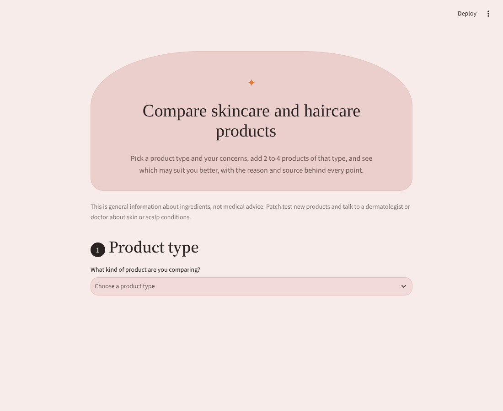
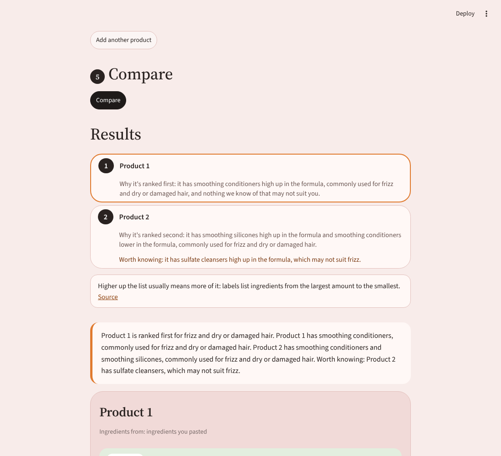
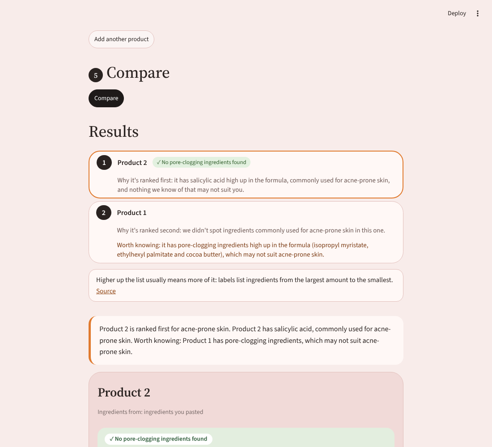

# Skincare and Haircare Compare

**Compare 2 to 4 skincare or haircare products by their real ingredient lists, and get a repeatable, sourced, plain-English answer, without trusting a chatbot's memory.**

AI only reads label photos and words the summary. Code and a hand-sourced rule table decide the ranking, so the same inputs always give the same answer, and every statement links to its source.



## Results at a glance

Measured against a plain AI chatbot given the same ingredient lists ([full findings](FINDINGS.md)):

| Measure | This app | Plain chatbot |
|---|---|---|
| Same ranking on every repeat run (10 comparisons × 3 runs) | **100%** | 0% |
| Answers with an invented claim or judgement word (30 answers) | **0** | 4 |
| Label-photo ingredients read exactly (AI readers, 0 invented) | **94.4%** | not measured |
| Barcodes found with an ingredient list in Open Beauty Facts (10, mostly Indian brands) | 3 of 10 | n/a |
| Automated tests | 455 passed | n/a |

The low barcode coverage is why pasting a list or snapping a label photo are first-class ways in, not fallbacks.

| Why it's ranked first | Pore-clogging check for acne-prone skin |
|---|---|
|  |  |

**Product docs:** [Product requirements (PRD)](docs/PRD.md) · [Architecture and decisions](ARCHITECTURE.md) · [Evaluation findings](FINDINGS.md)

**Built with:** Python, FastAPI, Streamlit, SQLite, Open Beauty Facts, Groq and Google Gemini free tiers, Tesseract OCR.

## Try it yourself

It runs locally on Windows, macOS or Linux in about 10 minutes. Everything is free.

| What you want to do | Needs an API key? |
|---|---|
| Paste ingredient lists and compare | **No** |
| Barcode or product-name lookup (Open Beauty Facts) | **No** (needs internet) |
| Ranking, "Why it's ranked..." lines, cautions and sources | **No** |
| Plain-English summary paragraph | No: without keys a built-in template writes it |
| Read a label photo accurately | **Yes**, a free [Groq](https://console.groq.com/keys) or [Gemini](https://aistudio.google.com/apikey) key. Without one, offline Tesseract OCR is used, which is much less accurate |

Quick start (macOS or Linux; Windows steps are below):

```bash
git clone https://github.com/SaumyaPai/skincare-compare.git
cd skincare-compare
python3 -m venv .venv && source .venv/bin/activate
pip install -r requirements.txt
cp .env.example .env        # optional: add your free keys here
python -m scripts.run_app   # opens http://localhost:8501
```

Then press **Compare** with your own pasted lists, or try the sample in [`data/try_example.json`](data/try_example.json).

## How it works

- **Grounded:** ingredient lists come only from Open Beauty Facts (by barcode or name), text you paste,
  or a photo of the label. They never come from an AI's memory.
- **Repeatable:** code and a rule table (`data/rules.csv`) decide the ranking. The same inputs always
  give the same answer.
- **Honest:** it never says "good" or "bad", gives no scores and makes no medical claims. Ties are shown
  as ties, and the disclaimer is always shown.
- **AI reads and explains, code decides:** AI is used only to read label photos and to word the summary.
  Every AI summary is checked by code and replaced by a built-in template if it breaks a rule or if the
  AI is unavailable.

How well it works is measured in [FINDINGS.md](FINDINGS.md). The design is in [ARCHITECTURE.md](ARCHITECTURE.md).

> **Disclaimer:** This is general information about ingredients, not medical advice. Patch test new
> products and talk to a dermatologist or doctor about skin or scalp conditions.

---

## Install on Windows (step by step)

You need about 15 minutes and an internet connection. Everything is free.

### 1. Install the programs (once)
1. **Python 3.12**: download from https://www.python.org/downloads/ and run the installer.
   **Tick "Add python.exe to PATH"** on the first screen.
2. **Tesseract** (optional: it reads label photos when no AI is available): install from
   https://github.com/UB-Mannheim/tesseract/wiki using the default folder `C:\Program Files\Tesseract-OCR`.
   (macOS: `brew install tesseract`; Linux: `sudo apt install tesseract-ocr`.)

### 2. Free AI keys (optional, recommended)
Without keys the app still works: summaries use the built-in wording, and photos are read offline (less accurately).
- Gemini: https://aistudio.google.com/apikey
- Groq: https://console.groq.com/keys

### 3. Download and set up
On this page, click **Code → Download ZIP** and unzip it into, for example, `D:\skincare` (or use `git clone`). Open **PowerShell** and paste these lines one at a time:

```powershell
cd D:\skincare\skincare-compare
python -m venv .venv
.\.venv\Scripts\Activate.ps1
python -m pip install -r requirements.txt
Copy-Item .env.example .env
notepad .env
```
In Notepad, paste your keys after `GEMINI_API_KEY=` and `GROQ_API_KEY=`, then save and close.

If `Activate.ps1` is blocked, run this once and try again:
`Set-ExecutionPolicy -Scope CurrentUser RemoteSigned`

### 4. Check it and start it
```powershell
python -m scripts.validate_data
python -m pytest -q
python -m scripts.run_app
```
- `validate_data` should end with **All checks passed**.
- The tests should end with **passed** (a few "skipped" is fine).
- `run_app` opens the page in your browser at http://localhost:8501. The version is shown under the title.
  Press **Ctrl + C** in the PowerShell window to stop it.

Next time, you only need:
```powershell
cd D:\skincare\skincare-compare
.\.venv\Scripts\Activate.ps1
python -m scripts.run_app
```

### 5. One-command final check (optional)
```powershell
python -m scripts.final_check
```
It runs every test, checks the product database and each AI key, measures photo reading, barcode
coverage, consistency and made-up claims, and ends with **RESULT: PASS** or **FAIL**. Results are
written to `eval_results\RESULTS.md`. It takes about 10 minutes; add `--quick` for a 2-minute version.

---

## How to use it
1. Choose the product type, then 1 to 3 concerns.
2. Optionally tell it about you (skin or scalp type, sensitive, avoid fragrance).
3. Add 2 to 4 products. For each, pick one of the following:
   - **Barcode**: type it and press Enter.
   - **Search by name**: type it, press Enter, and pick the right product from the list.
   - **Paste ingredients**: paste the list from the pack or a shop page.
   - **Label photo**: upload a photo of the ingredient list. It is read straight away. **Check the
     text against the label** and fix anything wrong.
4. Press **Compare**. Each product gets a "Why it's ranked..." line, "Worth knowing" cautions, the
   ingredients it was matched on, a source link for every statement, and its full ingredient list.

For acne-prone skin on leave-on products (toner, serum, moisturiser, face mask, sunscreen), a product
with none of the listed pore-clogging ingredients gets the tag **"No pore-clogging ingredients found"**.
This is an observation, not a promise.

---

## Editing the rules

Everything the tool knows is in plain CSV files in `data/`. Open them in Excel or Notepad. After any
change, run `python -m scripts.validate_data`. It names the exact row and column of any mistake.

| File | What it holds |
|---|---|
| `rules.csv` | One row per rule (see the columns below). Concerns appear in the dropdown only if a rule uses them. |
| `aliases.csv` | Other names for the same ingredient, e.g. `aqua` → `water`, `cocos nucifera oil` → `coconut oil`. |
| `product_types.csv` | Product types, skin or hair, and leave-on or rinse-off (rinse-off counts half). |
| `concerns.csv` | Concern ids, the dropdown label and the phrase used in sentences. |
| `profiles.csv` | The "about you" options. |

`rules.csv` columns:

| Column | Example | Meaning |
|---|---|---|
| `rule_id` | `R043` | A unique id |
| `ingredient_family` | `pore-clogging ingredients` | Rules with the same family count once in the ranking |
| `plain_name` | `pore-clogging ingredients` | How the shopper sees it |
| `match_terms` | `isopropyl myristate\|cocoa butter` | Standard ingredient names, separated by `\|` |
| `applies_to` | `serum\|moisturizer`, `skin_all`, `hair_all`, `all` | Product types the rule is used for |
| `relevant_profiles` | `concern:acne-prone`, `profile:sensitive` | When the rule applies |
| `flag_type` | `may_suit` or `may_not_suit` | Which way it points |
| `severity` | `low`, `medium`, `high` | How much it moves the ranking |
| `rationale` | one sentence | Shown to the shopper. Use "commonly used for", never "treats" or "cures". |
| `source` | `https://...` | Required: a real dermatology body or peer-reviewed source |

Ranking settings (severity weights, label position) are at the top of `app/config.py`.

---

## Project layout
```
app/        the API (FastAPI): lookup, photo reading, rules, ranking, summary
ui/         the page (Streamlit)
data/       the rule table and other CSV files you can edit
scripts/    run_app, final_check, validate_data, eval/ (Phase 6 measures)
tests/      automatic tests (pytest), including tests/fixtures/labels (two real label photos)
docs/       step-by-step guides for each build phase and update notes
```

## Privacy
- Your keys live only in `.env` on your computer. Never share that file.
- Only label photos, ingredient lists and the matched ingredients go to the AI services. Your profile and
  names are never sent. Free AI tiers may use what they receive to improve their services.

## Credits and licences
- Product and ingredient data: **[Open Beauty Facts](https://world.openbeautyfacts.org)**, available under
  the **[Open Database License (ODbL)](https://opendatacommons.org/licenses/odbl/1-0/)**. Individual
  contents are under the Database Contents License. Data is community-entered and may be incomplete or wrong,
  so the tool always shows where each ingredient list came from.
- AI: Google Gemini and Groq free tiers. Offline photo reading: Tesseract OCR (Apache 2.0).
- Sources for each rule are linked in `data/rules.csv` and on every result.
