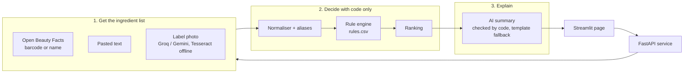

# Skincare & Haircare Product Comparison App - Product Requirements Document

2026-11-03 · Saumya

A grounded, repeatable tool that compares 2 to 4 skincare or haircare products of the same type by their real ingredient lists, and explains the result in plain words with a source for every statement. Version 1.0.0 is built and evaluated: it gave the same ranking in 100% of repeated runs (a plain chatbot: 0%) and made 0 invented claims in 30 answers (a plain chatbot: 4).

| Field | Detail |
|---|---|
| Product | Skincare and Haircare Compare |
| Version | 1.0.0 (released November 2026) |
| Status | Built, tested and evaluated |
| Author and product owner | Saumya |
| Platform | Local web app (Python, FastAPI, Streamlit, SQLite) |
| Related documents | README, ARCHITECTURE, FINDINGS |

## 1. Overview and problem statement

Shoppers choosing between similar skincare or haircare products cannot easily tell which one fits their concerns, and the tools they turn to today give answers they cannot trust or repeat.

**The problem.** A shopper in front of a shelf or a shopping site wants to know which of two to four similar products (say, three shampoos for dandruff) is more likely to suit them. Ingredient lists are long, written in INCI names and hard to read. The common shortcut is to ask an AI chatbot, which has three failures:

- **It invents.** A chatbot may name ingredients a product does not contain, or make claims such as "cures acne".
- **It is not repeatable.** Asked the same question three times, it can give three different orders.
- **It is not sourced.** It rarely shows where a claim comes from, so the shopper cannot check it.

**The solution.** Skincare and Haircare Compare takes ingredient lists only from real sources (Open Beauty Facts, pasted text or a label photo), applies a rule table that is written by hand and linked to a source for each rule, and ranks products with deterministic code. AI is used only to read label photos and to word the summary, and code checks every AI sentence before the shopper sees it.

**Product principles.**

1. **Grounded:** ingredients never come from an AI's memory.
2. **Repeatable:** the same inputs always give the same ranking.
3. **Sourced:** every "may suit" or "may not suit" note links to a dermatology body or a peer-reviewed source.
4. **Careful with words:** no "good" or "bad", no scores out of 100, no medical claims, and a disclaimer on every result.
5. **AI reads and explains, code decides.**

## 2. Goals and non-goals

The product succeeds if it gives a shopper the same, sourced, honest answer every time, from real ingredient data, at no cost.

**Goals**

| # | Goal | How it is measured |
|---|---|---|
| G1 | Rank products identically for identical inputs | Same order across repeated runs (target: 100%) |
| G2 | Never invent ingredients or claims | Invented claims or banned words in answers (target: 0) |
| G3 | Get real ingredient lists for as many products as possible | Barcode coverage, plus paste and photo as first-class inputs |
| G4 | Read label photos accurately | Share of ingredients read exactly (target: 90% or more, 0 invented) |
| G5 | Explain results in shopper language, with a source per statement | Every note carries a plain reason and a link |
| G6 | Keep running when free AI services are busy or down | Fallback chain always returns a result |
| G7 | Run entirely on free tools | No paid services in the stack |

**Non-goals**

- Giving medical advice, diagnosing conditions or recommending treatments.
- Scoring products out of 100, or calling any product "good", "bad" or "best".
- Comparing products of different types (for example a serum against a shampoo).
- Judging products by ingredient count or "fewer chemicals", since no evidence supports it.
- Guessing ingredients with fuzzy matching. Anything unknown is shown in the full list, never guessed.

## 3. Target users and personas

The primary user is an everyday shopper, often buying Indian brands, who compares a few products of one type for one to three concerns.

| Persona | Who they are | Need | What the app gives them |
|---|---|---|---|
| **Ananya, the label checker** | 22, acne-prone skin, buys serums and moisturisers online | Avoid products that may clog pores | The pore-clogging check and "Worth knowing" cautions, with sources |
| **Rohan, the in-store shopper** | 30, dandruff, standing in a pharmacy aisle with three shampoos | A fast answer without reading every ingredient | Barcode or label photo input and a one-line "Why it's ranked first" |
| **Meera, the sensitive-skin shopper** | 35, sensitive skin, prefers to avoid fragrance | To know which product may not suit her | Profile options that give more weight to cautions about irritants and fragrance |
| **Rule maintainer** | The product owner or a contributor who edits the rule table | Add or fix a rule safely | Plain CSV files and a validator that names the exact row and column of any mistake |

**Scope of use:** 12 product types (9 skin, 3 hair) and 13 concerns (7 skin, 6 hair and scalp).

## 4. User stories

Each story maps to the functional requirements in section 5.

| ID | As a... | I want to... | So that... | Acceptance criteria |
|---|---|---|---|---|
| US1 | shopper | pick a product type and 1 to 3 concerns | the comparison fits my situation | Only concerns backed by at least one rule for that type appear |
| US2 | shopper | add a product by barcode | I don't have to type its ingredients | Lookup runs on Enter; the real product name and data source are shown |
| US3 | shopper | search for a product by name | I can find it without the barcode | A short list of candidates is shown; the app never picks one for me |
| US4 | shopper | paste an ingredient list | I can compare products missing from the database | Pasted text is used as is and labelled as pasted |
| US5 | shopper | upload a photo of the label | I can compare a product in a shop | Text appears in an editable box with a "check against the label" prompt |
| US6 | shopper | see a ranking with a plain "why" line | I understand the order | Every product shows "Why it's ranked...", cautions and sources |
| US7 | shopper with acne-prone skin | know whether a leave-on product has pore-clogging ingredients | I avoid breakouts | Products with none show "No pore-clogging ingredients found" |
| US8 | sensitive shopper | have cautions weighted more for me | the order reflects my sensitivity | Matching cautions count 1.5 times |
| US9 | shopper | be told when products are tied | I am not given a false winner | Tied products share a rank and the summary says they are tied |
| US10 | shopper | be told when a product could not be found | nothing is guessed silently | Unresolved products are listed with a reason and next step |
| US11 | rule maintainer | edit rules in a spreadsheet | I can extend the tool without code | The validator reports the exact row and column of any error |

## 5. Functional requirements

The app has four ways in, one deterministic engine, and one checked explanation layer. Priority uses MoSCoW (Must, Should, Could).

### 5.1 Product input

| ID | Requirement | Priority |
|---|---|---|
| FR1 | **Barcode lookup** via the Open Beauty Facts API, with a custom User-Agent, a timeout, and a local SQLite cache valid for 30 days. If the service is down, an older cached copy is used and marked as possibly out of date. | Must |
| FR2 | **Name search** returns a short candidate list for the shopper to choose from. The app never picks a product by name on its own. | Must |
| FR3 | **Paste ingredients** from a pack or shop page. Pasted text takes precedence over other inputs for that product. | Must |
| FR4 | **Label photo reading** with AI. The AI first finds the ingredient area on a small copy, then reads a sharp, enlarged crop of the full photo. Photos up to 10 MB. | Must |
| FR5 | **AI fallback chain for photos:** Groq, then Gemini, then lighter Gemini models. A busy model is skipped for 5 minutes. A reply that looks cut short tries the next reader and is flagged "possibly incomplete". | Must |
| FR6 | **Offline OCR fallback** with Tesseract when no AI is available. Results are always marked "check every word". | Should |
| FR7 | The shopper can **review and edit** any photo-read text before comparing. | Must |
| FR8 | A product that cannot be resolved is **listed with its reason** (not found, no ingredients listed, source unavailable) and a next step, and left out of the ranking. | Must |

### 5.2 Comparison and ranking

| ID | Requirement | Priority |
|---|---|---|
| FR9 | Accept **one product type, 1 to 3 concerns, an optional profile and 2 to 4 products**. Invalid requests return a clear error. | Must |
| FR10 | **Normalise ingredients:** split on commas, semicolons, line breaks and "(and)", clean the text, and map names through an alias table. Matching is exact, never fuzzy. | Must |
| FR11 | **Rule engine:** a rule fires when the product type, an ingredient and a concern or profile tag all match. Each match becomes a "may suit" or "may not suit" note with reason and source. | Must |
| FR12 | **Ranking:** points from severity (low 1, medium 2, high 3) times application (leave-on 1.0, rinse-off 0.5). Cautions count 1.5 times for sensitive users. Points are never shown. | Must |
| FR13 | **Label position:** an ingredient in the first third of the list (always the first 5) counts fully; lower down it counts 0.6. This can be switched off. | Should |
| FR14 | **No double counting:** a rule counts once per product, and an ingredient family flagged the same way by several rules counts only its strongest rule. | Must |
| FR15 | **Ties and close calls:** equal points are broken by fewer cautions; if still equal, products share a rank and the summary says so. Neighbours differing by one ingredient group or less are marked as close. | Must |

### 5.3 Concerns and the pore-clogging check

| ID | Requirement | Priority |
|---|---|---|
| FR16 | The concern dropdown is **built from the rule table**: a concern with no rule for that product type never appears. | Must |
| FR17 | For **acne-prone skin on leave-on products** (toner, serum, moisturiser, face mask, sunscreen), a product with none of the listed pore-clogging ingredients gets the tag **"No pore-clogging ingredients found"**. It is worded as an observation, not a promise. | Must |
| FR18 | Profile options are non-medical only: skin type, scalp type, "sensitive" and "avoid fragrance". | Must |

### 5.4 Results and plain-language summaries

| ID | Requirement | Priority |
|---|---|---|
| FR19 | Each ranked product shows **"Why it's ranked first"** (or second, and so on) and, where relevant, **"Worth knowing"** cautions, built by code from the notes. | Must |
| FR20 | Every statement shows its **source link**, the matched ingredients, and a collapsed full ingredient list. | Must |
| FR21 | An **AI summary** of 3 to 6 sentences is written from the structured result only. Code rejects it for banned words (good, best, cure, treat and similar), any ingredient not in the result, or more than 150 words, and replaces it with a template. | Must |
| FR22 | Results use **shopper language**: system words such as flag, rule or ingredient group are never shown. | Should |
| FR23 | The **disclaimer** is added by code to every result. | Must |

## 6. Non-functional requirements

The app must be fast enough to use in a shop, never invent, and never leak the shopper's keys or personal details.

| Area | Requirement |
|---|---|
| **Latency** | Database lookups time out at 10 s and AI summaries at 15 s, then fall back. One photo gets at most 40 s of AI attempts before offline reading takes over. Measured photo reads took 2.7 s to 16.5 s. |
| **Consistency** | Ranking is pure code over a CSV rule table: identical inputs give identical output, every run. |
| **No invented claims** | Ingredients come only from Open Beauty Facts, pasted text or a photo. AI summaries see only the structured result and are checked by code before display. |
| **Wording and safety** | Only "may suit", "may not suit" and "commonly used for". No scores, judgement words or medical claims. Disclaimer on every result. |
| **Availability** | Every AI step has a fallback (next model, then template or offline OCR), so a comparison always completes. |
| **Privacy of keys** | API keys live only in a local `.env` file, excluded from version control by `.gitignore`. |
| **Data minimisation** | Only label photos, ingredient lists and matched ingredients go to AI services. Profiles and names are never sent. The request log stores timings and counts, not ingredients, profiles or photos. |
| **Transparency** | Every product shows where its ingredient list came from; every note links its source. |
| **Maintainability** | Rules, aliases, product types and concerns are plain CSV files checked by a validator. 455 automated tests pass. |
| **Cost** | Free tools only: Python, FastAPI, Streamlit, SQLite, Open Beauty Facts, and free tiers of Gemini and Groq. |
| **Licensing** | Open Beauty Facts data is credited under the Open Database License (ODbL). |

## 7. Success metrics and results

v1.0.0 met every target it was measured on, and beat a plain AI chatbot on both consistency and invented claims. Results are from one full evaluation run on 23 November 2026 (free AI tiers), reproducible with a single command.

| Metric | Target | Result: this app | Baseline: plain chatbot |
|---|---|---|---|
| Same ranking across repeated runs (10 comparisons × 3 runs) | 100% | **100%** | 0% |
| Answers with an invented claim or judgement word (30 answers) | 0 | **0 of 30** | 4 of 30 |
| Label photo reading, ingredients read exactly (AI) | 90% or more | **94.4%** (98.6% allowing small spelling slips) | Not measured |
| Ingredients invented by the photo reader | 0 | **0** | Not measured |
| Label photo reading, offline OCR (no AI) | Reported | 15.5% exact, 22.5% allowing slips | Not applicable |
| Time to read a photo | Reported | 2.7 s to 16.5 s | Not applicable |
| Barcodes found with an ingredient list (10 products, mostly Indian brands) | Reported | **3 of 10** (1 found without ingredients, 6 not found) | Not applicable |
| Automated tests | All pass | **455 passed**, 2 skipped, 0 failed | Not applicable |

**What the numbers mean for the product.**

- **Repeatability is the clearest win.** The chatbot changed its order at least once in every one of the 10 comparisons; the app never did.
- **Paste and photo are the main way in, not the fallback.** With only 3 of 10 barcodes returning ingredients, accurate photo reading is what makes the app usable for Indian products.
- **The fallback chain works.** During the run one Gemini model was busy; other readers took over and the result was still a pass.

**Limits of the evidence.** Samples are small (2 label photos, 10 barcodes, 10 comparisons), so the numbers show direction, not precise rates. The invented-claims check is automatic and catches named ingredients and banned words, not every misleading sentence.

## 8. Architecture summary

A Streamlit page talks only to a FastAPI service, which gets the ingredient list, decides the ranking with code, and uses AI only at the edges.

AI never touches the middle stage, which is why the ranking repeats exactly.

| Layer | Technology | Role |
|---|---|---|
| User interface | Streamlit | Step-by-step page: type, concerns, profile, products, results |
| API | FastAPI, Uvicorn, Pydantic | Endpoints for options, product lookup, photo extraction and compare; clear error contract |
| Ingredient data | Open Beauty Facts API (httpx) | Barcode and name lookup, credited under ODbL |
| AI | Groq and Google Gemini free tiers | Reads label photos and words summaries, behind one swappable module |
| Offline OCR | Tesseract | Reads photos when no AI is available |
| Storage | SQLite (`app.db`) | Product cache and an anonymous request log only |
| Knowledge | CSV files | Rules, aliases, product types, concerns, profiles |
| Quality | pytest, evaluation scripts | 455 tests and a one-command final check |

## 9. Assumptions and constraints

**Assumptions**

- Ingredient labels list ingredients above 1% from largest to smallest amount, so position on the label is a fair signal of how much is present.
- Rinse-off products (face wash, soap, shampoo, conditioner) touch the skin briefly, so their notes count half.
- Shoppers will check photo-read text against the label before comparing.
- A small, hand-sourced rule table is more trustworthy than a large, unsourced one.

**Constraints**

- **Free tools only.** No paid APIs, hosting or databases.
- **Free AI tiers** have rate limits, can be busy, and may use submitted content to improve their services.
- **Open Beauty Facts** is community-entered: coverage of regional brands is patchy and data can be wrong.
- **English only**, runs locally on Windows, single user.
- **Rule table size:** 44 sourced rules (31 "may suit", 13 "may not suit") and 67 aliases. Ingredients outside the table are listed, never interpreted.
- **Evidence varies.** Some rules (for example pore-clogging ingredients, caffeine for hair fall) rest on lab or small studies, and their rationale says so.

## 10. Risks and mitigations

The largest risks are thin barcode coverage and AI unreliability; both are handled by design rather than left to chance.

| Risk | Likelihood | Impact | Mitigation |
|---|---|---|---|
| Products missing from Open Beauty Facts, or listed without ingredients | High | Medium | Paste and photo as first-class inputs; honest "not found" message with a next step |
| AI misreads or invents ingredients from a photo | Medium | High | Two-step crop-and-read; editable result; "possibly incomplete" warning; measured 0 invented |
| AI summary adds claims or sounds medical | Low-Medium | High | AI sees only the structured result; code checks every reply and falls back to a template; disclaimer added by code |
| Free AI tiers busy, limited or unavailable | High (Gemini was busy about 8 of 10 times in development) | Medium | Multi-provider fallback chain with cooldowns; template summaries; offline OCR |
| Shopper reads the ranking as medical advice | Low | High | No scores or judgement words; "commonly used for" wording; disclaimer on every result |
| Weak or wrong rule sources | Medium | High | Every rule needs a real link; validator blocks missing sources |
| Ingredient spelled in a way the table doesn't know | High | Medium | Alias table; unmatched names shown in the full list, never guessed |
| API key accidentally shared | Low | High | Keys only in `.env`, excluded by `.gitignore`; keys can be revoked and replaced |

## 11. Out of scope for v1

- Makeup and other cosmetics.
- User accounts, saved comparisons and history.
- Prices, shopping links or affiliate recommendations.
- Languages other than English.
- Mobile apps and public hosting.
- Comparing products of different types.
- Medical profile questions (age, pregnancy, allergies, conditions).

## 12. Roadmap and future work

The next release should prove the product with real users and widen what it can read and recognise.

1. **Scale the evaluation** to 30 label photos and at least 5 barcodes per product type, using the existing scripts.
2. **Grow the rule table and aliases**, especially for ingredients common in Indian brands.
3. **Free online hosting** so others can try it without installing.
4. **Later:** more languages, a mobile-friendly camera flow, and leave-on face masks as their own product type.

